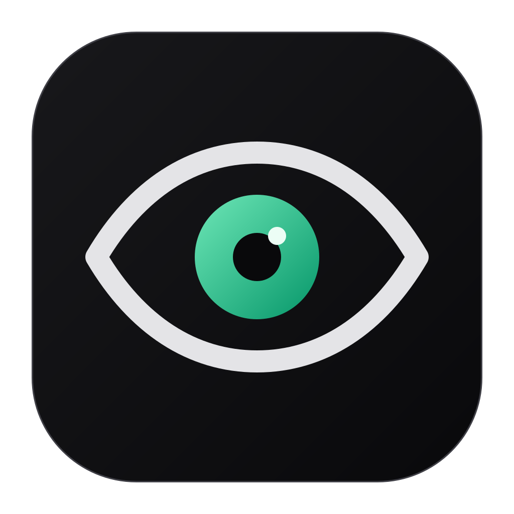
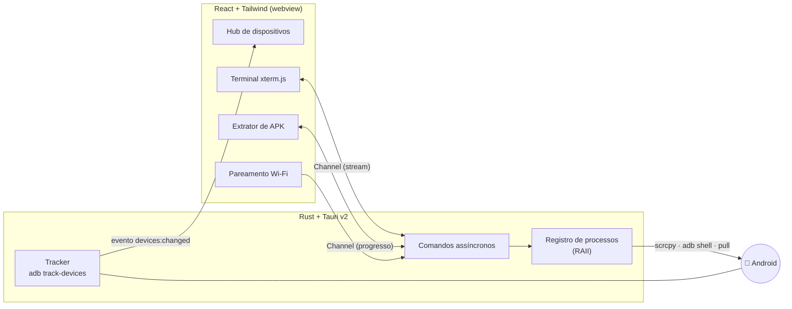

<div align="center">



# androidsEye

**Veja, espelhe e controle seus aparelhos Android, sem decorar um único comando `adb`.**

Um hub desktop que transforma o Android Debug Bridge em uma interface visual, rápida e em tempo real.

<br />


</div>

---

## 👁️ Por que o androidsEye existe

O `adb` é poderoso, mas exige terminal, comandos de memória e paciência: descobrir o serial, lembrar a flag certa,
copiar o caminho de um APK, parear pelo Wi-Fi com IP, porta e código...

O **androidsEye** deixa tudo isso **visível e a um clique**. Você conecta o celular e ele aparece. Clica e a tela está
espelhada. Abre um shell sem sair do app. Extrai um APK escolhendo da lista. O objetivo é que **qualquer pessoa**
(dev, QA, suporte técnico ou quem só quer ver a tela do celular no PC) controle seus aparelhos com confiança,
entendendo o que está acontecendo, sem medo de errar um comando.

<table>
<tr><th>Sem o androidsEye</th><th>Com o androidsEye</th></tr>
<tr>
<td>

```sh
adb devices -l
adb -s R58M12... shell getprop ro.product.model
scrcpy -s R58M12... --turn-screen-off
adb -s R58M12... shell pm list packages -f -3 | grep app
adb -s R58M12... pull /data/app/~~x==/com.app-y==/base.apk
adb pair 192.168.0.10:37123 482915
adb connect 192.168.0.10:41235
```

</td>
<td>

- Os aparelhos **aparecem sozinhos** em cards
- **Espelhar** → um clique
- **Shell** → terminal integrado na lateral
- **APK** → busca, escolhe, salva em Downloads
- **Parear** → aponta a câmera para o QR Code

</td>
</tr>
</table>

---

## ✨ Funcionalidades

### 📱 Hub de dispositivos em tempo real
- A lista se atualiza **sozinha** ao plugar, desplugar ou autorizar um aparelho. Não existe botão de "atualizar".
- Cada card mostra **modelo, fabricante, serial/IP, bateria** (com indicação de carregamento) e o tipo de conexão
  (**USB** ou **Wi-Fi**).
- Status claros: 🟢 **Online** · 🟡 **Não autorizado**, com o passo a passo para aceitar a chave RSA · ⚪ **Offline**.
- **Um card por aparelho físico**: mesmo que o adb enxergue o celular por USB, mDNS e IP ao mesmo tempo, você vê só um.

### 🖥️ Espelhamento de tela
- Um clique abre o [scrcpy](https://github.com/Genymobile/scrcpy) com a **tela física desligada**, para economizar
  bateria e manter a privacidade.
- O card indica quando o espelhamento está ativo, e o processo é encerrado sozinho se o cabo cair.

### ⌨️ Shell ADB integrado
- Terminal completo com **xterm.js** numa gaveta lateral, sem sair do hub.
- Redimensionamento real (`top`, `vi` e afins se ajustam), cores, links clicáveis.
- **Ctrl+Shift+C / V** e clique direito para copiar e colar, e **Ctrl+C** continua interrompendo o processo.
- Ao fechar, a sessão termina de forma limpa (`exit`). Nenhum `adb shell` fica órfão.

### 📦 Extração de APK
- Lista de apps **em ordem alfabética**, com busca instantânea e destaque do termo.
- Alterna entre **apps do usuário** e **todos** (incluindo os de sistema).
- Salva com o diálogo nativo do sistema, já apontando para **Downloads**, com **barra de progresso** e cancelamento.

### 📶 Pareamento por Wi-Fi (Android 11+)
Na primeira vez que você ativa a Depuração por Wi-Fi, o celular **só aparece depois de pareado**. O androidsEye
oferece as duas formas nativas do Android:

| | Como funciona |
|---|---|
| **QR Code** | O app gera o código; o celular lê pela câmera do menu de depuração. Pareia e conecta sozinho. |
| **Código de pareamento** | O app **encontra o celular na rede** automaticamente; você só digita os 6 dígitos. |
| **Já pareado** | Conexão direta por `IP:porta`. |

E, para desfazer, **Desparear** faz este computador esquecer o aparelho (e, se você quiser, desliga a Depuração por
Wi-Fi no celular). O app pede confirmação antes.

### 🧰 Dependências sob controle
- Ao abrir, o app verifica se `adb` e `scrcpy` estão disponíveis e, se faltar algo, mostra **como instalar** no seu
  sistema.
- No Windows, o **instalador já baixa e configura tudo** (veja abaixo).

---

## 📥 Instalação

### Windows: instalador completo

Baixe o `androidsEye_x.y.z_x64-setup.exe` na página de **Releases** e execute. O instalador:

1. Instala o androidsEye para o seu usuário (não pede permissão de administrador);
2. **Baixa a versão mais recente do scrcpy** direto do GitHub oficial, conferindo o SHA-256 do arquivo;
3. Coloca o scrcpy, que **já inclui o `adb`**, no **PATH do usuário**, para você também usá-los no terminal.

> Sem internet na hora da instalação? Tudo bem: o app é instalado mesmo assim e, ao abrir, mostra como instalar o
> scrcpy. Ao desinstalar, a pasta do scrcpy e a entrada no PATH são removidas.

### Linux e macOS

Instale as dependências e depois o pacote do androidsEye (`.deb`, `.AppImage` ou `.dmg`):

| Sistema | Comando |
|---|---|
| Ubuntu / Debian | `sudo apt install android-tools-adb scrcpy` |
| macOS (Homebrew) | `brew install android-platform-tools scrcpy` |

> Já tem o adb ou o scrcpy em outro lugar? Aponte com as variáveis `ADB_PATH` e `SCRCPY_PATH`.

---

## 🚀 Primeiros passos

1. **Ative as Opções do desenvolvedor**: *Configurações › Sobre o telefone* › toque 7× em **Número da versão**.
2. **Por cabo:** ative **Depuração USB**, plugue o celular e toque em **Permitir** no aviso que aparece na tela.
3. **Por Wi-Fi:** ative **Depuração por Wi-Fi**, clique em **Adicionar dispositivo** no androidsEye e escaneie o
   QR Code (celular e computador na mesma rede).
4. Pronto: o card aparece e as ações **Espelhar**, **Shell** e **APK** ficam disponíveis.

---

## 🏗️ Como funciona por dentro



- **Tempo real sem polling:** um `adb track-devices` de longa duração recebe cada mudança direto do servidor adb.
- **Streaming assíncrono:** saída do shell e progresso de download usam `tauri::ipc::Channel` com `tokio::process`,
  sem bloquear a interface.
- **Nenhum processo órfão:** cada `scrcpy`, `adb shell` e download pertence a um handle. Descartar o handle (fechar o
  painel, desconectar o cabo, fechar o app) encerra o processo.
- **Erros que ajudam:** um `enum AdbError` serializável chega ao frontend com **mensagem e dica de solução**
  (ex.: *"Desbloqueie o aparelho e toque em Permitir"*).
- **APK byte a byte:** `adb exec-out cat` com contagem real de bytes, para um progresso preciso e verificação de
  integridade no fim.

---

## 🛠️ Desenvolvimento

**Pré-requisitos:** [Rust](https://rustup.rs), [Node.js](https://nodejs.org) 20+ e os
[pré-requisitos do Tauri](https://tauri.app/start/prerequisites/) para o seu sistema.

```sh
npm install
npm run tauri dev      # app com hot reload
npm run tauri build    # instalador (no Windows: NSIS com download automático do scrcpy)
```

```sh
cd src-tauri
cargo test             # testes do backend (parsers do adb, mDNS, known hosts, fusão de transportes...)
cargo clippy           # lint
```

<details>
<summary><b>Estrutura do projeto</b></summary>

```
src/                          React + TypeScript
├─ components/
│  ├─ DeviceHub.tsx           tela principal
│  ├─ DeviceCard.tsx          card com status e ações
│  ├─ AdbTerminal.tsx         shell com xterm.js
│  ├─ ApkExtractorModal.tsx   lista de apps e download
│  ├─ pairing/                QR Code, código de 6 dígitos, conexão manual
│  └─ ui/                     botões, modais, diálogos, controles
├─ hooks/                     useDevices, useDependencies, usePairingServices
└─ lib/                       API tipada do backend

src-tauri/                    Rust + Tauri v2
├─ src/
│  ├─ devices.rs              tracker em tempo real e fusão de transportes
│  ├─ process.rs              ciclo de vida dos processos (RAII)
│  ├─ mirror.rs · shell.rs    scrcpy e shell interativo
│  ├─ packages.rs             apps instalados e extração de APK
│  ├─ pairing.rs              pareamento e despareamento Wi-Fi via mDNS
│  ├─ known_hosts.rs          aparelhos pareados que o adb lembra
│  └─ error.rs                AdbError → { kind, message, hint }
└─ windows/                   hooks do instalador NSIS + script do scrcpy
```

</details>

---

<div align="center">
<sub>Feito com Rust, React e muito <code>adb</code> por trás, para você não precisar digitar nenhum.</sub>
</div>
